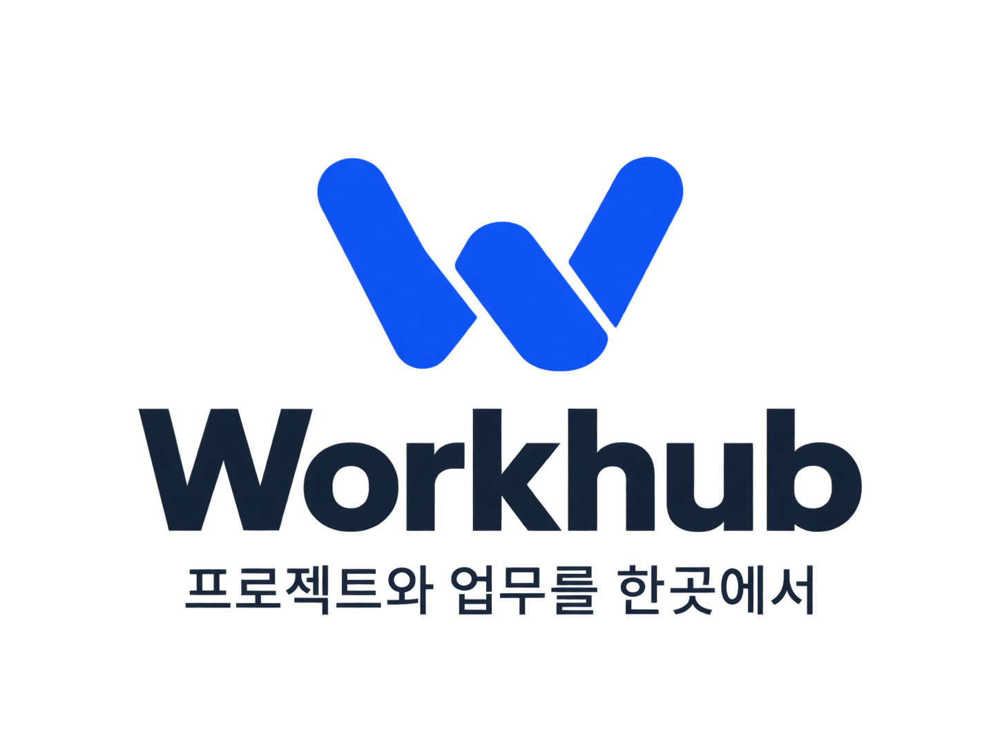
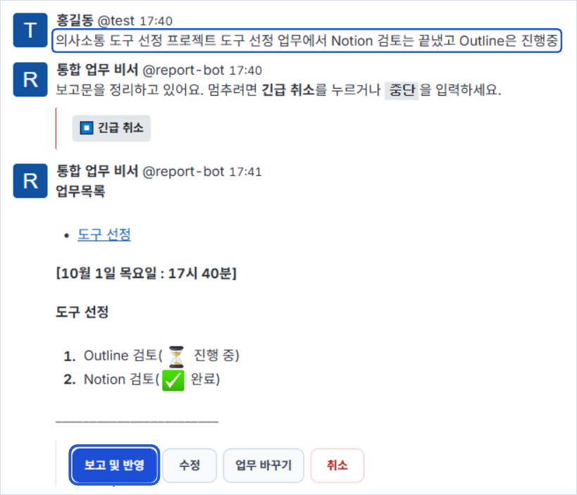
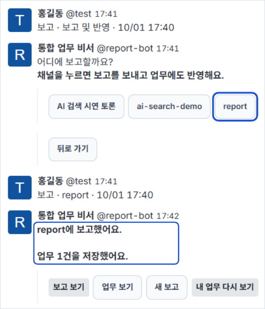
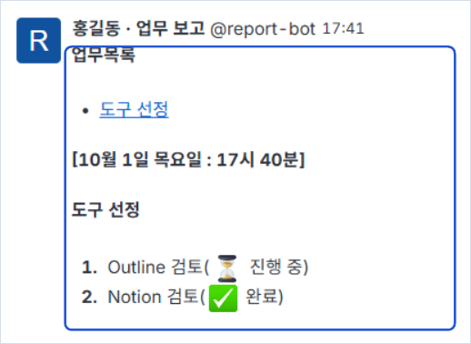
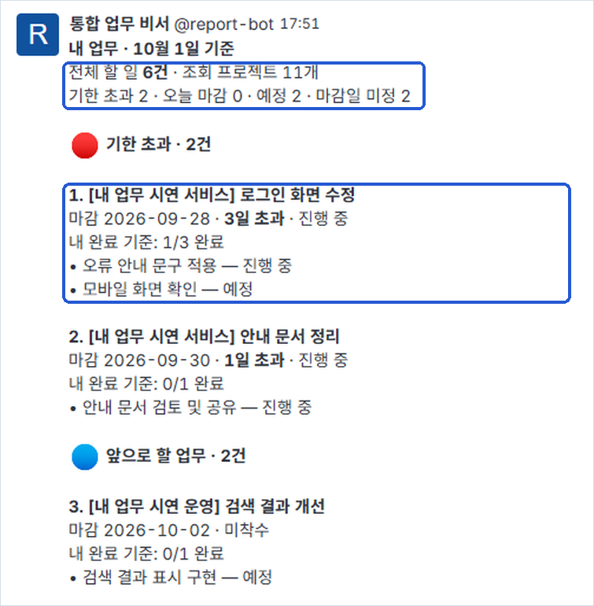
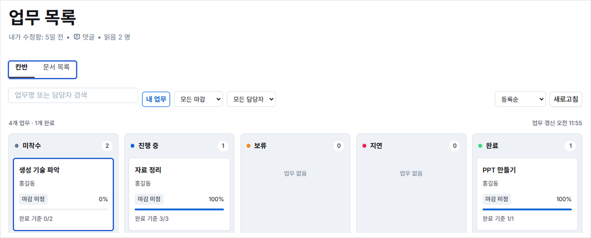
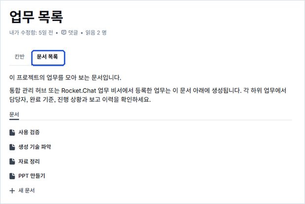
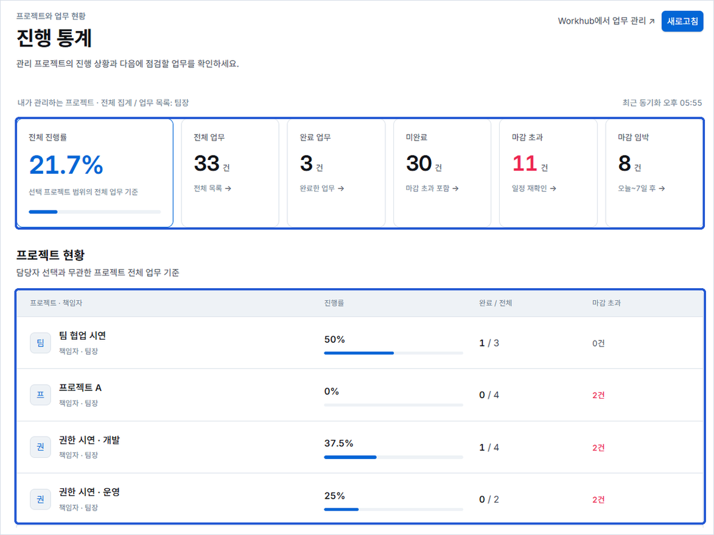
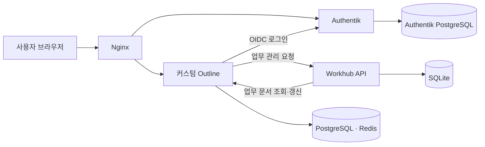
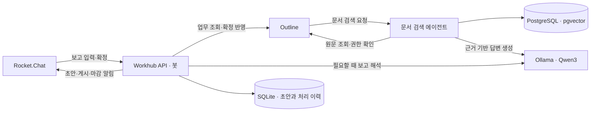

# Workhub

**채팅에 쓴 진행 보고를 프로젝트 업무에 반영하는 사내 업무 비서**

## Service Overview

Workhub는 Rocket.Chat의 채팅과 Outline의 업무 문서를 연결하는 현장실습 프로젝트입니다. 담당자가 봇에게 진행 상황을 한 문장으로 보내면, Workhub가 대상 업무와 완료 기준을 찾아 보고 초안을 만듭니다. 담당자가 초안을 확인하고 게시할 채널을 고르면, 보고가 채팅방에 게시되고 Outline의 업무 문서에도 반영됩니다.

Outline에서는 프로젝트별로 업무를 등록하고 담당자와 완료 기준을 지정할 수 있습니다. 진행 상황은 칸반과 통계에서 확인합니다. 로컬 테스트 구성은 여기에 채팅 보고, 개인 마감 알림, 문서 AI 검색을 연결합니다. 운영용 구성은 Outline과 Authentik 로그인, 업무 관리 API를 중심으로 구성했습니다.

## Tech Stack

| Area | Stack |
| --- | --- |
| 문서·업무 화면 | Outline 1.10.0, React, TypeScript, ProseMirror |
| Outline 서버 | Node.js, Koa |
| 업무 관리 API | Python, FastAPI, Uvicorn, SQLite |
| 인증·배포 | Authentik(OIDC), Nginx, Docker Compose |
| 문서 저장 | PostgreSQL, Redis(Outline 캐시·작업 큐) |
| 채팅 연동 · 로컬 | Rocket.Chat 8.5.0, MongoDB |
| 보고 해석·문서 검색 · 로컬 | Ollama, Qwen3 4B, Open WebUI, PostgreSQL + pgvector, multilingual-e5-small |

## Key Features

### 채팅 보고 · 로컬

Rocket.Chat에서 업무 진행 상황을 한 문장으로 보내면, 봇이 대상 업무와 완료 기준을 찾아 보고 초안을 보여 줍니다. 초안을 확인하고 **보고 및 반영**을 누르면 게시할 채널을 선택할 수 있습니다. 확정한 보고는 선택한 채팅방에 게시되고 Outline 업무 문서에도 반영됩니다.

<table>
  <tr>
    <th align="left">문장 입력과 보고 초안</th>
    <th align="left">채널 선택과 반영 확인</th>
  </tr>
  <tr>
    <td valign="top"></td>
    <td valign="top"></td>
  </tr>
</table>

채널에 게시된 보고 보기

 

### 내 업무 모아보기와 마감 알림 · 로컬

봇에게 `내 업무`를 보내면 여러 프로젝트의 담당 업무를 마감 상태별로 모아 보고, 각 업무의 마감일과 완료 기준을 확인할 수 있습니다. 오전 9시(한국 시간)에는 미완료 마감 업무를 개인 대화로 안내합니다. 알림에서 업무 문서로 바로 이동하거나 수신을 끌 수 있습니다. [채팅 시연 가이드](docs/local/내_업무_시연_가이드.md) · [마감 알림 검증](docs/local/마감_알림_구현_검증_결과.md)

### 업무 등록과 칸반

Outline 컬렉션을 프로젝트에 연결하고 업무에 담당자, 마감일, 완료 기준을 지정합니다. 업무 목록에서 카드를 다른 열로 옮겨 상태를 바꾸거나 **문서 목록** 탭으로 전환할 수 있습니다. 게시된 문서의 선택 영역을 출처와 함께 업무로 등록하고, 일일 업무보고의 미완료 항목을 이월할 수도 있습니다. [Outline 변경 고지](docs/local/integrations/outline/MODIFICATIONS.md) · [일일 업무보고 변경 기록](docs/production/changes/DAILY-REPORT.txt)

문서 목록 탭 보기

 

### 프로젝트 진행 통계

프로젝트·담당자·마감 기간별로 업무 진행률과 마감 일정을 확인합니다. 관리자는 접근 권한이 있는 관리 범위의 통계를 볼 수 있고, 직원의 통계는 본인이 참여한 업무로 제한됩니다. [통계 화면과 권한 검증](docs/local/Outline_진행_통계_구현_검증_결과.md)

### 출처를 보여 주는 문서 검색 · 로컬

Outline 검색 화면에서 **AI 검색**을 선택하면 문서 비서가 키워드와 벡터 검색 결과를 결합합니다. 현재 읽을 수 있는 Outline 원문을 확인해 답변과 출처 링크를 제공합니다. [검색 구현 및 검증](docs/local/검색_기능_강화_구현_검증_결과.md)

## System Architecture

### 운영용 · Outline 업무 관리

Outline이 업무 문서의 원본을 관리하고 Workhub API가 업무 등록, 상태 변경, 진행 통계를 처리합니다. [운영용 Compose 구성](production/compose.yaml)

### 로컬 테스트용 · 채팅 보고와 AI 검색

채팅 보고는 사용자 확인을 거쳐 Outline에 반영됩니다. 문서 검색은 색인에서 후보를 찾은 뒤 Outline에서 현재 권한과 원문을 확인합니다. [로컬 구성과 검증 범위](docs/local/OVERVIEW.md)

## Challenges & Solutions

### 1. 대상 업무가 명확해도 보고 초안이 늦게 생성되는 문제

최신 업무 목록에서 업무와 완료 기준이 하나로 정해지면 직접 연결하고, 모호한 보고에는 후보 탐색을 적용했습니다. 같은 PC에서 입력별로 전후 각 2회 측정한 결과, 한 프로젝트의 업무 두 건은 평균 **11.510초 → 4.629초**, 두 프로젝트의 업무 두 건은 **10.766초 → 4.472초**로 줄었습니다. 두 입력 모두 모델 호출은 전후 0회였고, 검색 후보 API 호출은 보고당 1회에서 0회로 줄었습니다. [측정 기록](docs/local/보고_성능_및_신뢰성_개선_명세.md) · [직접 해석 테스트](unified-work-assistant/src/workhub/test_report_fastpath.py)

### 2. 초안 확인 중 문서 내용이나 권한이 바뀌는 문제

확정 직전에 최신 문서와 수정 권한을 다시 확인합니다. 초안을 생성했을 때와 문서가 달라지면 저장을 멈추고 다시 확인하도록 안내합니다. 채팅 게시와 문서별 저장 결과를 SQLite에 따로 기록해, 일부 처리에 실패해도 이미 반영된 내용을 확인하고 남은 작업만 재시도합니다. [보고 확정·재시도 테스트](unified-work-assistant/src/workhub/test_reports.py)

### 3. 재시작이나 응답 유실로 마감 알림이 중복되는 문제

발송 직전에 업무 상태, 열람 권한, 알림 설정을 재확인하고, 발송 이력과 메시지 ID를 저장합니다. 재시작 후에는 당일 기록을 확인하고, 응답이 유실되면 같은 메시지 ID로 발송 여부를 확인합니다. 기존 로컬 시험에서는 대상 3명의 개인 대화로 발송을 확인했습니다. [구현·검증 기록](docs/local/마감_알림_구현_검증_결과.md) · [알림 테스트](unified-work-assistant/src/workhub/test_deadline_alerts.py)

## Repository Guide

| 경로 | 내용 |
| --- | --- |
| [unified-work-assistant/](unified-work-assistant/) | Workhub API·봇, 문서 검색 에이전트, 기존 보고 PoC, Outline 연동 패치 |
| [production/](production/) | 운영용 업무 관리 API, Outline 변경·추가 파일, Authentik·Nginx·Compose 설정 예시 |
| [docs/](docs/) | 기능 설계, 검증 결과, 라이선스와 제3자 소프트웨어 고지 |

이 공개본은 코드와 설계 검토용입니다. 로컬 Compose에는 별도의 환경 설정이 필요하고, 운영용 Outline 소스를 구성할 때는 [고정된 버전의 원본](unified-work-assistant/integrations/outline/upstream.lock.json)이 필요합니다. [로컬 실행 범위](docs/local/OVERVIEW.md) · [Outline 원본 복원 안내](docs/local/integrations/outline/MODIFICATIONS.md)

## License

Workhub 프로젝트 작성물에는 이 공개본으로 추가 이용 허락을 부여하지 않습니다. Outline 1.10.0의 수정·파생 부분에는 원본 **Business Source License 1.1**이 적용됩니다. Rocket.Chat은 설정에서 외부 이미지를 참조하며, Community의 MIT 적용 범위와 Enterprise의 별도 조건은 원문에서 확인할 수 있습니다. [저장소 이용 범위](LICENSE) · [라이선스 안내](docs/LICENSING.md) · [제3자 소프트웨어 고지](docs/THIRD_PARTY_NOTICES.md)
