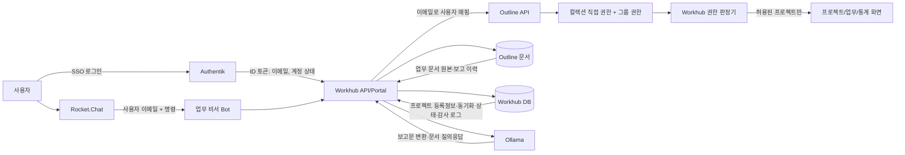
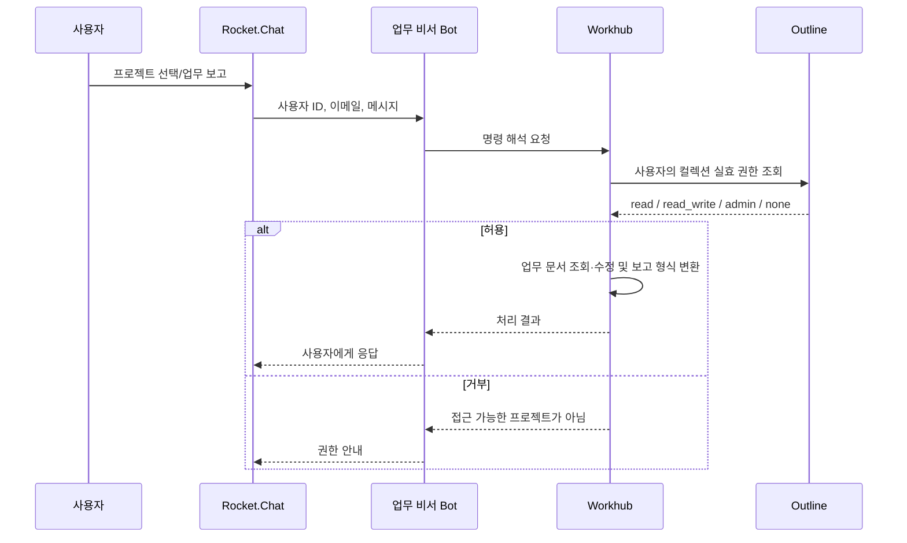

# Outline 컬렉션 기반 프로젝트 권한 설계 및 구현 명세

> **구현 전 설계 참고 문서입니다.** 아래의 “현재 구현”과 “변경할 부분”은 작성 당시를 뜻합니다. 실제 적용 범위·제한·테스트는 권한 구현 결과를 기준으로 확인하세요.

## 1. 문서 목적

이 문서는 Workhub 포털과 Rocket.Chat 업무 비서가 **Outline 컬렉션 권한을 프로젝트 권한의 기준**으로 사용하도록 구현하기 위한 명세다.

목표는 다음과 같다.

- 사용자는 Authentik 계정으로 한 번 로그인한다.
- Workhub에 표시되는 프로젝트는 사용자가 Outline에서 접근 가능한 컬렉션으로 제한한다.
- 프로젝트 관리자는 자신이 `관리자(Admin)` 권한을 가진 컬렉션만 관리한다.
- 업무자는 자신이 `열람(View)` 또는 `편집(View & Edit)` 권한을 가진 컬렉션만 볼 수 있다.
- Outline의 일반 문서와 업무 관리 문서를 같은 컬렉션에 함께 보관한다.
- 권한 검사는 화면 표시뿐 아니라 모든 API와 Rocket.Chat 명령에서 반복한다.

## 2. 현재 구현 상태와 변경이 필요한 부분

현재 구현은 컬렉션별로 업무 데이터와 통계를 나누지만, 사용자별 프로젝트 접근 권한은 분리하지 않는다.

- Authentik의 `work-assistant-users` 그룹이 Workhub 로그인 가능 여부를 결정한다.
- Authentik의 `work-assistant-admins` 그룹은 전역 관리자 역할을 부여한다.
- 로그인한 사용자를 등록된 모든 Outline 프로젝트 컬렉션에 자동으로 추가한다.
- 일반 사용자는 모든 등록 프로젝트에 `read`, 전역 관리자는 `admin` 권한으로 추가된다.
- `/api/projects`는 등록된 프로젝트 전체를 반환한다.

따라서 지금 상태에서는 “Outline에서 권한을 가진 컬렉션만 포털에 표시”하는 요구사항이 충족되지 않는다. 다음 구현에서는 자동 멤버 추가 동작을 제거하고, Outline에 이미 설정된 사용자·그룹·컬렉션 권한을 읽어 판단해야 한다.

## 3. 목표 시스템 구조



### 구성요소별 책임

| 구성요소 | 책임 | 권한 기준으로 사용 여부 |
|---|---|---|
| Authentik | 로그인, 계정 활성화, Workhub 사용 가능 여부 | 인증 및 서비스 진입 권한 |
| Outline | 프로젝트 컬렉션, 문서, 사용자·그룹별 컬렉션 권한 | 프로젝트별 권한의 최종 기준 |
| Workhub | 권한 판정, 업무 문서 해석, 배정·보고·통계 API | 모든 요청에서 Outline 권한 집행 |
| Rocket.Chat | 대화형 입력과 결과 전달 | Workhub가 판정한 권한을 그대로 적용 |
| Ollama | 보고 형식 변환, 요약, 질의응답 | 직접 권한 판단 금지 |
| Workhub DB | 프로젝트 등록, 동기화 상태, 감사·캐시 데이터 | Outline 권한을 복제해 원본으로 사용하지 않음 |

## 4. 인증과 권한의 분리

### 4.1 Authentik이 결정하는 것

- 사용자가 정상 계정인지
- Workhub 로그인이 가능한지
- 이메일, 이름, 사용자 식별자
- 시스템 운영 기능에 접근 가능한지

`work-assistant-admins`는 프로젝트 전체 열람권이 아니라 다음과 같은 시스템 운영 권한으로 제한한다.

- Outline 컬렉션을 Workhub 프로젝트로 등록 또는 연결
- 동기화 상태 확인
- 서비스 상태 및 오류 확인
- 시스템 설정 관리

프로젝트 문서·업무·통계 접근은 전역 관리자라도 해당 Outline 컬렉션 권한을 별도로 확인한다. 긴급 운영용 전체 접근이 필요하면 일반 관리자와 분리된 명시적 `break-glass` 설정을 두고 감사 로그를 남긴다.

### 4.2 Outline이 결정하는 것

- 사용자가 어떤 프로젝트 컬렉션을 볼 수 있는지
- 컬렉션에서 문서를 열람하거나 편집할 수 있는지
- 프로젝트의 권한과 업무 배정을 관리할 수 있는지

프로젝트는 Workhub에 등록된 Outline 컬렉션 하나와 1:1로 대응한다.

```text
Workhub 프로젝트 ID -> Outline collection_id
```

포털에 표시할 프로젝트 집합은 다음 교집합이다.

```text
Workhub에 등록된 프로젝트 컬렉션
∩
현재 사용자가 Outline에서 접근 가능한 컬렉션
```

## 5. 권한 모델

Outline의 컬렉션 권한을 Workhub 역할로 다음과 같이 변환한다.

| Outline 실효 권한 | Workhub 역할 | 가능한 작업 |
|---|---|---|
| 없음 | 접근 불가 | 프로젝트 목록에도 표시하지 않음 |
| View | 열람자 | 프로젝트·업무·문서·현재 진행상태 열람 |
| View & Edit | 업무자 | 열람, 업무 작성·수정, 자신에게 배정된 완료 기준 보고 |
| Admin | 프로젝트 관리자 | 열람·편집, 완료 기준 생성·배정·상태 변경, 프로젝트 통계와 보고 관리 |

직접 사용자 권한과 그룹 권한이 동시에 있으면 Outline과 동일하게 가장 높은 권한을 적용한다.

```text
none < read < read_write < admin
```

권장 그룹 구성 예시는 다음과 같다.

| Outline 그룹 | 컬렉션 권한 | 용도 |
|---|---|---|
| `프로젝트-A-관리자` | Admin | 담당 프로젝트 관리자 |
| `프로젝트-A-업무자` | View & Edit | 업무 작성 및 진행 보고 담당자 |
| `프로젝트-A-열람자` | View | 참조·검토 사용자 |

Outline 워크스페이스의 기본 컬렉션 접근은 `없음`으로 설정하고, 필요한 사용자 또는 그룹만 각 컬렉션에 추가한다.

### 그룹 운영 시 주의점

Outline의 컬렉션 관리자는 해당 컬렉션의 권한을 관리할 수 있지만, 워크스페이스 전체 그룹의 구성원 추가·삭제는 Outline 배포 버전과 역할 설정에 따라 워크스페이스 관리자 권한이 필요할 수 있다.

따라서 초기 구현은 다음 중 하나를 택한다.

1. **권장 초기안:** 프로젝트 관리자가 컬렉션 권한 화면에서 사용자를 직접 추가하고 권한을 지정한다.
2. **그룹 중심 운영안:** 워크스페이스 관리자가 프로젝트별 그룹 구성원을 관리하고, 프로젝트 관리자는 완료 기준 배정만 수행한다.
3. **확장안:** Workhub에 프로젝트 관리자용 구성원 관리 화면을 만들고, 서버가 허용된 컬렉션 범위에서만 Outline 그룹 또는 직접 권한을 수정한다.

그룹 자체를 프로젝트 관리자가 쉽게 관리해야 한다면 3번을 후속 기능으로 구현하는 것이 가장 자연스럽다.

## 6. 사용자 식별과 실효 권한 계산

### 6.1 사용자 매핑

Authentik 사용자와 Outline 사용자는 검증된 이메일 주소로 연결한다.

```text
Authentik token.email == Outline user.email
```

다음 조건에서는 접근을 거부한다.

- 토큰에 이메일이 없음
- 이메일 검증이 완료되지 않음
- 동일 이메일의 Outline 사용자를 찾지 못함
- 사용자가 비활성화 또는 정지 상태임

장기적으로 이메일 변경에 대비해 최초 연결 후 Authentik `sub`와 Outline `user_id` 매핑을 Workhub DB에 저장할 수 있다. 이메일은 최초 연결 키로만 사용한다.

### 6.2 실효 권한 계산 순서

1. Authentik 토큰을 검증한다.
2. Authentik 사용자를 Outline 사용자로 매핑한다.
3. 요청한 프로젝트의 `collection_id`를 조회한다.
4. 사용자의 컬렉션 직접 권한을 조회한다.
5. 사용자가 속한 모든 Outline 그룹의 컬렉션 권한을 조회한다.
6. 직접 권한과 그룹 권한 중 가장 높은 권한을 실효 권한으로 선택한다.
7. 엔드포인트가 요구하는 최소 권한과 비교한다.
8. 부족하면 응답 데이터 없이 거부한다.

프로젝트 존재 여부를 권한 없는 사용자에게 노출하지 않도록 개별 프로젝트 API는 원칙적으로 `404 Not Found`를 반환한다. 로그인 실패는 `401`, 로그인은 되었지만 허용된 기능 등급이 부족한 경우는 `403`을 사용할 수 있다.

## 7. API별 권한 검사 기준

| 기능/API 영역 | 최소 권한 | 추가 조건 |
|---|---|---|
| 프로젝트 목록 | View | 허용된 컬렉션만 반환 |
| 프로젝트 상세 | View | 요청마다 컬렉션 권한 확인 |
| 업무 목록·상세 | View | 해당 컬렉션 업무만 반환 |
| 문서 검색·질의응답 | View | 검색 대상도 허용된 컬렉션으로 제한 |
| 업무 생성 | View & Edit | 선택 컬렉션에 문서 생성 권한 필요 |
| 업무 일반 필드 수정 | View & Edit | 문서 버전 충돌 검사 유지 |
| 자신의 완료 기준 상태 보고 | View & Edit | 기준 항목의 담당자 이메일과 현재 사용자 일치 |
| 타인의 완료 기준 상태 변경 | Admin | 감사 로그 기록 |
| 완료 기준 생성·삭제·배정 | Admin | 배정 후보도 해당 프로젝트 구성원으로 제한 |
| 프로젝트 통계 | Admin | 해당 프로젝트만 집계 |
| 프로젝트 보고서 확정·게시 | Admin | 원본 업무 버전 재검사 |
| 프로젝트 등록·연결 | Authentik 시스템 관리자 | 등록 후에도 데이터 접근은 Outline 권한 필요 |

다음 원칙을 모든 API에 공통 적용한다.

- 프런트엔드에서 버튼을 숨기는 것만으로 권한을 보장하지 않는다.
- 서버가 `collection_id`, `document_id`, `task_id`의 소속 컬렉션을 직접 확인한다.
- 클라이언트가 보낸 역할이나 이메일을 신뢰하지 않는다.
- 문서 ID로 직접 호출해도 동일한 컬렉션 권한 검사를 수행한다.
- 통계와 검색에서도 권한 없는 프로젝트 데이터가 섞이지 않도록 원본 쿼리 단계에서 제한한다.

## 8. Rocket.Chat 명령 흐름

Rocket.Chat 사용자는 이메일 또는 고정된 외부 사용자 ID 매핑으로 Authentik·Outline 사용자와 연결한다.



적용 규칙은 다음과 같다.

- 프로젝트 선택 목록에는 사용자가 접근 가능한 컬렉션만 표시한다.
- 이전에 선택한 프로젝트의 권한이 제거되면 다음 명령부터 선택을 무효화한다.
- 업무 보고 전 `View & Edit` 이상과 완료 기준 담당자 일치 여부를 검사한다.
- 프로젝트 전체 보고, 배정, 완료 기준 관리는 `Admin`만 허용한다.
- 자연어 명령을 LLM이 해석하더라도 최종 권한 판정은 Workhub 코드가 수행한다.

## 9. 업무 목록 문서를 인식하는 현재 방식

Workhub는 컬렉션의 모든 문서를 업무로 간주하지 않는다. 동기화 시 컬렉션의 게시된 문서를 읽고, 본문에 다음 고정 표식이 있는 문서만 업무 문서 후보로 인식한다.

```text
업무 유형: 통합 업무
```

표식이 있으면 다음 필드를 파싱한다.

```text
프로젝트:
담당자:
마감일:
상태:
진행률:
장애요인:
다음 행동:
결과물:
```

완료 기준을 사용하는 경우 본문에 다음 섹션과 형식을 둔다.

```markdown
## 완료 기준

- [ ] C-12345678 | 로그인 화면 구현 | 담당자: worker@example.com | 상태: 예정
- [ ] C-87654321 | 접근 권한 검증 | 담당자: worker@example.com | 상태: 진행 중
- [x] C-11223344 | 화면 설계 승인 | 담당자: manager@example.com | 상태: 완료
```

`### 보고 기록` 이후의 내용은 현재 상태 필드와 완료 기준을 해석할 때 제외한다. 과거 보고문 속 문구가 현재 업무 상태로 잘못 인식되는 것을 막기 위한 처리다.

### 인식 결과

| 문서 상태 | Workhub 처리 |
|---|---|
| 고정 표식 없음 | 일반 문서로 판단하고 업무 목록·통계에서 제외 |
| 표식 있음 + 필드 정상 | 업무로 등록해 배정·보고·통계에 사용 |
| 표식 있음 + 필드 오류 | 유효하지 않은 업무로 표시하고 정상 통계에서는 제외 |
| 보관·삭제·미게시 문서 | 동기화 대상에서 제외 |

## 10. 같은 컬렉션에서 일반 문서와 업무 문서 함께 사용하기

가능하다. 프로젝트 컬렉션 하나에 다음 문서를 함께 둘 수 있다.

```text
프로젝트 A 컬렉션
├─ 프로젝트 개요                 ← 일반 문서
├─ 요구사항                      ← 일반 문서
├─ PRD                           ← 일반 문서
├─ 회의록                        ← 일반 문서
├─ 기술 설계                     ← 일반 문서
├─ [업무] 인증 화면 구현          ← 업무 표식이 있는 문서
└─ [업무] 관리자 통계 화면 구현   ← 업무 표식이 있는 문서
```

일반 문서는 표식이 없으므로 Workhub의 진행률·배정·업무 통계에는 들어가지 않는다. Outline에서는 평소처럼 저장, 검색, 열람, 편집할 수 있다. Workhub의 문서 질의응답 기능은 사용자의 컬렉션 열람 권한 범위에서 이러한 일반 문서도 검색 자료로 사용할 수 있다.

일반 문서에 설명 예시로 정확한 표식 문자열을 넣으면 업무 문서로 잘못 인식할 수 있다. 따라서 업무 표식은 업무 템플릿에서만 사용한다.

### 권장 개선안

현재 표식 방식은 단순하고 시연하기 쉽다. 운영 안정성을 높이려면 다음 규칙을 추가한다.

1. 업무 문서는 Workhub의 `새 업무` 버튼 또는 Outline 업무 템플릿으로 생성한다.
2. 표식은 문서 첫 번째 비어 있지 않은 줄에 있을 때만 유효하도록 파서를 강화한다.
3. `스키마 버전`과 불변 `업무 ID`를 추가한다.
4. 제목의 `[업무]` 접두사는 사용자가 알아보기 위한 표시로만 쓰고 판정 기준으로 삼지 않는다.
5. AI 분류나 제목 추정으로 업무 여부를 결정하지 않는다.

권장 업무 헤더 예시는 다음과 같다.

```text
업무 유형: 통합 업무
스키마 버전: 1
업무 ID: T-01JABCDEFGH
```

폴더처럼 보이는 `업무 관리` 상위 문서 아래에 업무 문서를 모아둘 수도 있지만, 실제 업무 판정의 최종 기준은 표식과 스키마여야 한다.

## 11. 데이터 저장 기준

Outline은 업무의 원본 저장소다.

- 업무 제목과 상태
- 담당자
- 마감일
- 진행률
- 장애요인과 다음 행동
- 완료 기준과 담당자
- 보고 기록

Workhub DB에는 다음 운영 데이터만 저장한다.

- Workhub 프로젝트와 Outline `collection_id` 연결
- Authentik `sub`와 Outline `user_id` 연결
- 짧은 수명의 권한 조회 캐시
- 문서 동기화 버전과 오류
- 변경·배정·보고·관리 작업 감사 로그
- Rocket.Chat 사용자와 인증 사용자 연결

Outline 권한을 Workhub DB에 독립된 장기 권한표로 복제하지 않는다. 권한의 최종 원본은 Outline이다.

## 12. 권한 캐시와 변경 반영

읽기 성능을 위해 사용자별 컬렉션 권한을 짧게 캐시할 수 있다.

권장 정책:

- 프로젝트 목록과 단순 조회: 최대 30초 캐시
- 문서 수정, 완료 보고, 배정, 보고서 확정: Outline 권한을 즉시 다시 조회
- 권한 조회 실패: 기존 캐시로 쓰기 허용 금지
- 권한 제거: 다음 쓰기 요청에서 즉시 반영, 읽기는 최대 캐시 시간 안에 반영
- 캐시 키: `outline_user_id + collection_id`

권한 확인에 사용되는 Outline 서비스 토큰은 넓은 API 권한을 가질 수 있으므로, Workhub가 사용자 실효 권한을 확인하기 전에 문서 내용을 반환하거나 수정해서는 안 된다.

## 13. 구현 변경 목록

### `src/workhub/auth.py`

- Authentik 인증과 시스템 운영 역할만 처리한다.
- 프로젝트 권한을 전역 `admin` 플래그로 결정하지 않는다.
- Authentik `sub`, 검증된 이메일, 계정 상태를 정규화한다.

### `src/workhub/outline.py`

- 로그인 사용자를 모든 컬렉션에 자동 추가하는 `ensure_member` 흐름을 제거한다.
- 이메일로 Outline 사용자를 조회하는 기능을 추가한다.
- 직접 컬렉션 권한과 그룹 컬렉션 권한을 조회한다.
- 실효 권한을 `none/read/read_write/admin`으로 반환한다.
- 사용자가 접근 가능한 등록 프로젝트만 반환한다.
- 문서 ID에서 소속 컬렉션을 역조회할 수 있게 한다.

### `src/workhub/main.py`

- 공통 의존성 또는 미들웨어로 `require_collection_permission()`을 추가한다.
- 모든 프로젝트·업무·통계·보고 API에 최소 권한을 선언한다.
- `/api/projects` 응답을 사용자별로 필터링한다.
- `/api/assignees`는 해당 컬렉션 구성원만 반환한다.
- 권한 없는 리소스에 일관된 오류 응답을 적용한다.

### `src/workhub/bot.py`

- Rocket.Chat 사용자를 Authentik·Outline 사용자에 연결한다.
- 프로젝트 목록과 선택을 사용자 권한으로 제한한다.
- 각 명령 실행 직전에 권한을 다시 검사한다.

### `src/workhub/assistant.py`

- 검색, 보고서 작성, 완료 처리 전에 허용된 `collection_id`만 입력받는다.
- LLM의 해석 결과를 신뢰해 권한 검사를 생략하지 않는다.

### `src/workhub/store.py`

- 사용자 연결, 권한 캐시, 감사 로그 테이블을 추가한다.
- 권한 원본을 저장하는 영구 ACL 테이블은 만들지 않는다.

### `src/workhub/domain.py`, `src/workhub/criteria.py`

- 기존 업무 표식과 보고 변환 형식을 유지한다.
- 표식을 첫 유효 줄에만 허용하도록 강화한다.
- 스키마 버전과 업무 ID를 단계적으로 추가한다.
- 기존 문서는 마이그레이션 기간에 계속 읽을 수 있어야 한다.

## 14. 구현 순서

1. 자동 컬렉션 멤버 추가를 중단한다.
2. Authentik 사용자와 Outline 사용자 매핑을 구현한다.
3. Outline 실효 컬렉션 권한 조회기를 구현한다.
4. `/api/projects`를 사용자별로 필터링한다.
5. 모든 읽기 API에 `View` 검사를 적용한다.
6. 모든 쓰기 API에 `View & Edit` 또는 `Admin` 검사를 적용한다.
7. 완료 기준 담당자 일치 검사를 적용한다.
8. Rocket.Chat 프로젝트 목록과 명령에 같은 검사기를 적용한다.
9. 통계·검색의 컬렉션 범위를 제한한다.
10. 권한 캐시와 감사 로그를 추가한다.
11. 업무 문서 파서를 강화하되 기존 문서 호환성을 검증한다.
12. 시연용 사용자·그룹·컬렉션을 구성하고 인수 테스트를 수행한다.

## 15. 마이그레이션 절차

현재 자동으로 추가된 컬렉션 권한이 남아 있으면 새 필터를 구현해도 모든 프로젝트가 계속 보일 수 있다. 배포 전에 다음 순서로 정리한다.

1. 현재 사용자별 컬렉션 직접 권한을 내보내 백업한다.
2. 프로젝트별 관리자·업무자·열람자 그룹 또는 직접 권한표를 확정한다.
3. Outline 컬렉션의 기본 접근을 `없음`으로 변경한다.
4. 프로젝트별 그룹과 권한을 추가한다.
5. 기존 자동 부여된 직접 권한을 제거한다.
6. Workhub의 `ensure_member` 호출을 비활성화한 버전을 배포한다.
7. 관리자, 업무자, 열람자, 무권한 사용자로 각각 확인한다.

권한 정리와 자동 추가 중단은 같은 배포 작업으로 처리해야 한다. 둘 중 하나만 먼저 적용하면 사용자가 일시적으로 과도한 권한을 갖거나 접근하지 못할 수 있다.

## 16. 필수 인수 테스트

### 프로젝트 표시

- 프로젝트 A만 권한이 있는 사용자는 A만 본다.
- 프로젝트 B 관리자라도 A 권한이 없으면 A를 보지 못한다.
- 권한이 없는 사용자가 A의 URL 또는 API를 직접 호출하면 내용을 받지 못한다.
- Outline에서 권한을 제거하면 Workhub와 Rocket.Chat에서 반영된다.

### 역할별 기능

- 열람자는 업무와 문서를 볼 수 있지만 수정·보고·배정할 수 없다.
- 업무자는 업무를 작성·수정하고 자신에게 배정된 기준을 보고할 수 있다.
- 업무자는 다른 사람의 완료 기준을 완료 처리할 수 없다.
- 프로젝트 관리자는 완료 기준을 만들고 프로젝트 구성원에게 배정할 수 있다.
- 프로젝트 관리자는 담당 프로젝트 통계만 볼 수 있다.

### 일반 문서와 업무 문서

- 같은 컬렉션의 PRD는 업무 목록에 나타나지 않는다.
- 표식과 필드가 정상인 문서만 업무 목록에 나타난다.
- 잘못된 업무 문서는 오류 상태로 표시되고 정상 진행률 통계에서 제외된다.
- 일반 문서는 권한이 있는 사용자에게 Outline 검색·질의응답 자료로 사용된다.

### Rocket.Chat

- 봇의 프로젝트 선택 목록이 포털과 동일하다.
- 권한 없는 프로젝트 이름을 직접 입력해도 접근할 수 없다.
- 업무자는 자신에게 배정된 항목만 보고할 수 있다.
- 권한이 제거된 뒤 저장된 프로젝트 선택값으로 명령해도 거부된다.

### 보안 회귀

- 다른 컬렉션의 `document_id`를 바꿔 넣어도 데이터가 노출되지 않는다.
- 통계 합계에 권한 없는 프로젝트가 포함되지 않는다.
- LLM 프롬프트에 권한 없는 문서 본문이 전달되지 않는다.
- Outline API 오류 시 쓰기 작업이 허용되지 않는다.

## 17. 완료 기준

다음 조건을 모두 만족하면 구현 완료로 본다.

- Authentik 로그인 사용자가 Outline 사용자와 안정적으로 매핑된다.
- 프로젝트 목록이 Outline 실효 컬렉션 권한으로 필터링된다.
- 포털과 Rocket.Chat의 모든 읽기·쓰기 경로가 동일한 서버 권한 검사기를 사용한다.
- 프로젝트 관리자는 자신의 Admin 컬렉션만 관리한다.
- 업무자는 접근 가능한 컬렉션에서만 업무를 보고한다.
- 같은 컬렉션에 일반 문서와 업무 문서를 함께 저장할 수 있다.
- 일반 문서가 업무 통계에 잘못 포함되지 않는다.
- 권한 변경과 제거가 정해진 캐시 시간 안에 반영된다.
- 역할별·직접 URL·문서 ID 변조·통계 누출 테스트를 통과한다.

## 18. 권장 최종 운영 방식

- **Authentik:** 계정 생성, 로그인, 퇴사자 비활성화, Workhub 서비스 사용 허용
- **Outline:** 프로젝트 컬렉션별 실제 열람·편집·관리 권한
- **Workhub:** Outline 권한에 따른 포털 화면, 업무 배정·보고·통계
- **Rocket.Chat:** Workhub의 동일 권한 정책을 사용하는 대화형 업무 입력 채널
- **Outline 일반 문서:** 프로젝트 개요, 요구사항, PRD, 회의록, 기술 문서
- **Outline 업무 문서:** 명시적인 업무 표식과 스키마를 가진 문서만 진행률과 배정 대상으로 사용

이 구조에서는 담당자가 익숙한 Outline 화면에서 프로젝트 구성원과 권한을 관리할 수 있고, Workhub는 별도의 프로젝트 권한표를 또 관리하지 않는다. 동시에 Authentik은 회사 전체 계정과 로그인 정책을 일관되게 유지한다.

